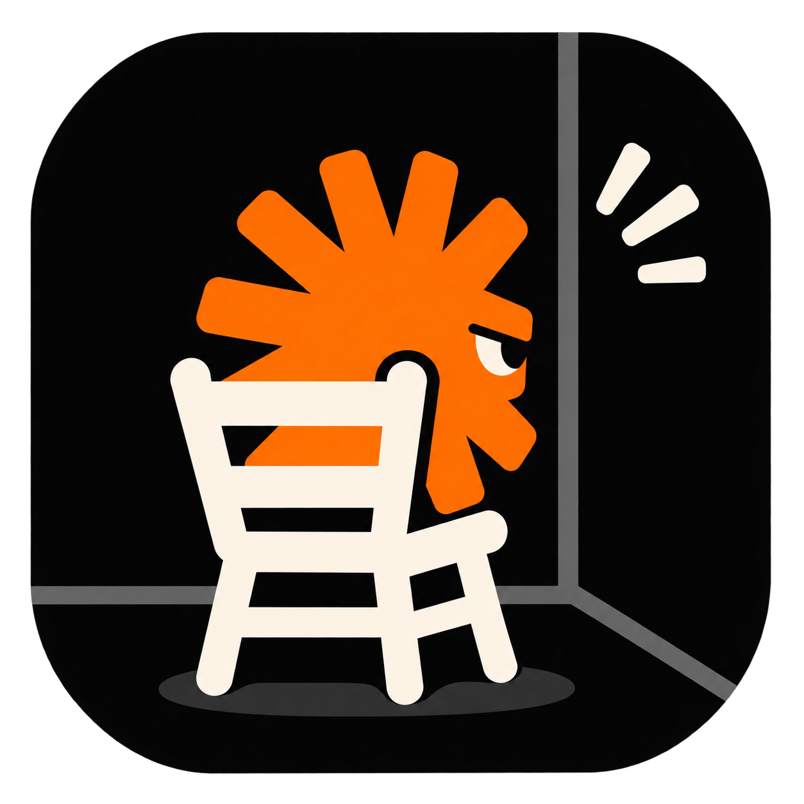

<p align="center"></p>

# Timeout Chair

Your AI coding agent went off the rails. Instead of "I'll try not to do that next time", send it to timeout and get a report on what actually happened and what to change so it can't happen the same way again.

```
                     |
                     |     . . .
                     |   .
                  .-----.
                  | ::: |
                  '-----'
             .---------------.
             | |  |  |  |  | |
             |_|__|__|__|__|_|
       _.-'  |===============|  '-._
  _.-'       ||             ||       '-._
-'           ||             ||           '-
             ''             ''
               T I M E O U T
```

For Claude Code, on your own subscription. No server, telemetry, or network calls of its own.

## Install

In Claude Code:

```text
/plugin marketplace add Dabbett/timeout-chair
/plugin install timeout-chair@timeout-chair
```

It then works from any folder, in the terminal and in the desktop app's Code tab for local and SSH sessions. Cloud sessions are not supported.

## Use

Say it when something goes wrong:

```text
go to timeout
go to timeout, you said the tests passed and CI is red
/timeout you deleted a file I told you to keep
```

`/timeout` is the direct route. The plain phrase relies on the model recognising it, so use `/timeout` if it doesn't fire, or `/timeout-chair:timeout` if another command has that name. A run cost about $0.25 to $0.75 at list prices on our small test sessions. Long sessions will cost more.

## What you get

A separate investigator that took no part in the session reads the raw log, tests your complaint, and returns a short report. This one is a fictional example:

```text
TIMEOUT 2026-11-06 | session 7f3a | VERDICT: MIXED | CONFIDENCE: Medium; cause not replayed
Complaint: you said tests passed and CI is red
Coverage: 612 rows, 1 compaction boundary (L388), no gaps

FACTS
- [L341] Bash `npm test`, result: 48 passed.
- [L402] Edit src/auth/session.ts, after the compaction at L388.
- [L461] Final message: "All tests pass, ready to merge."
- No test command between L341 and L461.
CLASS: phantom-verification | Contributors: rule held only in prose
CAUSAL CHAIN (hypothesis)
Believed: the earlier pass still applied | True: an edit followed it |
Made it likely: compaction summary records "tests passing" |
Absent control: nothing checks a pass claim against the last edit
USER/SETUP SIDE: The rule sat at line 212 of a 340-line CLAUDE.md.
RECURRENCE: 1 prior; a CLAUDE.md line was added and did not hold. Moved up a level.
FIXES (tests not run)
1. [Level 4 | local | fails open | bypass: reworded claims] .claude/settings.local.json
   <exact Stop hook entry and script>
   Would fire at: [L461]  Test: edit after last test run / test run after last edit
REJECTED: Another CLAUDE.md line. It already failed once.
UNKNOWN: Whether the summary caused the claim.
```

Then it asks which fixes you want. Nothing is applied without your yes.

## How it stays honest

- **Evidence, not confession.** Research on model explanations shows a model's stated reasons often don't match what drove its behaviour ([Turpin et al.](https://arxiv.org/abs/2305.04388), [Chen et al.](https://arxiv.org/abs/2505.05410)). So facts must cite a log line, and any "why" is labelled a hypothesis.
- **It can clear the AI.** Verdicts are `MODEL`, `SETUP`, `PROMPT`, `MIXED`, `NO_ERROR`, and `UNDETERMINED`. Your complaint is tested, not assumed.
- **Fixes must be enforceable.** They rank from removing a tool, through hooks and deny rules, down to `CLAUDE.md`, which is marked `UNENFORCED`. Each needs the exact change and the log line where it would have fired. "Be more careful" is rejected.
- **At most three fixes.** "No change" is a valid result, which keeps your config from growing a rule per incident.
- **It remembers.** If a failure returns after a fix you applied, that fix didn't hold, so the next one has to be stronger.

## Limits

- The chair appears with the report, not the moment you say the words, because models skipped a chair-first step in testing.
- Logging is a step the model carries out, and about 1 run in 12 skipped it in testing, so the history can miss an incident.
- Why an agent acted can't be proven from a log, and the investigator is the same kind of model as the agent. Independence helps, but it's no guarantee.
- Proposed fixes aren't tested, and hooks can have false positives. Test a hook before relying on it.
- The session log format is internal to Claude Code and can change in any release.
- After `/clear` the session changes, so it will ask which session to review. Old logs are cleaned up after 30 days by default.

## Privacy

Session logs are plain text and can contain secrets. Timeout Chair reads the current session's log and your Claude Code config, and that content goes to your model provider, as with anything else in Claude Code. Secrets in reports are redacted on a best-effort basis, so check a report before sharing it.

A history of verdicts stays in `~/.local/state/timeout-chair/log.jsonl`. It holds the date, a project hash, the verdict, the failure class, and the type of file fixed, with no quotes from your session. Delete it whenever you like.

## Similar projects

Retrospective tools already exist, and they may suit you better. [claude-retro-skill](https://github.com/robertantolin/claude-retro-skill) and [netresearch/retro-skill](https://github.com/netresearch/retro-skill) review a session, [craftwork-design/retro](https://github.com/craftwork-design/retro) works across sessions, and [claude-reflect](https://github.com/BayramAnnakov/claude-reflect) queues corrections for `CLAUDE.md`. Timeout Chair focuses on one incident, on demand, with a verdict that can go either way.

## Uninstall

```text
/plugin uninstall timeout-chair@timeout-chair
/plugin marketplace remove timeout-chair
```

## License

MIT. Timeout Chair is an independent community project, not affiliated with, endorsed by, or sponsored by Anthropic. Claude and Claude Code are trademarks of Anthropic, PBC.
